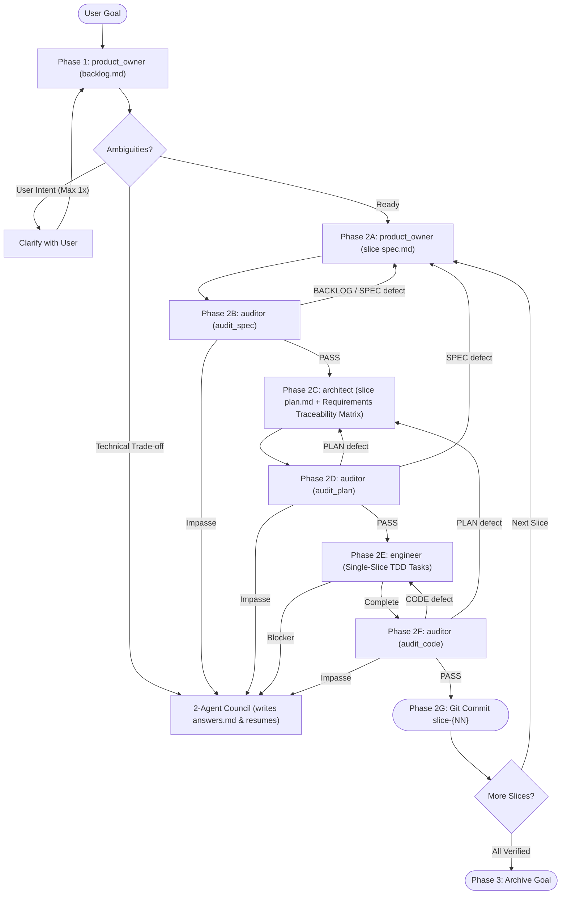
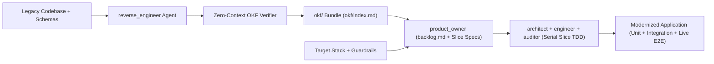

# ASDLC & Modernization Toolkit

An [Antigravity Plugin](https://antigravity.google/docs/build-plugins/) providing an **Agentic SDLC (`asdlc`)** orchestrator for feature delivery, greenfield builds, and clean-room legacy modernization via Open Knowledge Format (`okf/`), alongside repository complexity analysis and user story generation skills.

**Credits**: [@dandobrin](https://github.com/ddobrin), [@jjdelorme](https://github.com/jjdelorme) & [@cedricyao](https://github.com/cedricyao). Parts of this work were adapted from Dan's [production serverless repository](https://github.com/GoogleCloudPlatform/serverless-production-readiness-java-gcp/tree/main/genai/quotes-llm/.gemini/commands).

## Prerequisites
Install the [Google Antigravity CLI (`agy`)](https://antigravity.google/docs/cli/reference) or Antigravity App / IDE.

## Plugin Installation

Install directly from GitHub using the Antigravity CLI:

```bash
agy plugin install https://github.com/jjdelorme/plan-commands
```

Or validate and install from a local clone:

```bash
# Validate plugin.json and all bundled skills/agents
agy plugin validate --strict .

# Install into ~/.gemini/config/plugins/plan-commands
agy plugin install .

# Verify installation
agy plugin list
```

*(Alternatively, run `./deploy.sh` for Antigravity or `./deploy-opencode.sh` for OpenCode.)*

The plugin bundles **4 skills** (`asdlc`, `create-user-stories`, `repo-stats`, `agent-platform-skill-registry`) and **5 custom agents/subagents** (`reverse_engineer`, `product_owner`, `architect`, `engineer`, `auditor`).

### Plugin Directory Structure

```text
plan-commands/
├── plugin.json               # Antigravity plugin manifest
├── README.md                 # Plugin documentation
├── deploy.sh                 # Antigravity validator & installer
├── deploy-opencode.sh        # OpenCode converter & installer
├── assets/
│   └── logo.svg              # Plugin icon (1:1 SVG)
├── agents/                   # Custom agents & subagents
│   ├── architect/agent.md
│   ├── auditor/agent.md
│   ├── engineer/agent.md
│   ├── product_owner/agent.md
│   └── reverse_engineer/agent.md
└── skills/                   # Bundled skills
    ├── agent-platform-skill-registry/
    ├── asdlc/
    ├── create-user-stories/
    └── repo-stats/
```

---

## Agentic SDLC (`asdlc`)

Invoke `/asdlc` or ask Antigravity to use the `asdlc` skill for features, greenfield services, or clean-room rebuilds:

> Use the `asdlc` skill to add OAuth login to this service.

Every engagement follows a 3-level unit-of-work taxonomy (**`Goal -> Backlog -> Slice -> Task`**): a **Goal** (`plans/active/{goal}/`) owns a **Backlog** (`backlog.md`) of single-capability vertical **Slices** (`slice-{NN}-{slug}/`, `1 Capability = 1 Slice = 1 Git Commit`), each built through `Red -> Green -> Refactor` TDD **Tasks** (`- [ ]` in `plan.md`).

The agent acts as the **ASDLC Supervisor** and drives the **Spec -> Plan -> TDD -> Audit** state machine: clarifying user intent at most once up front in interactive mode, resolving technical trade-offs and blockers via a **2-Agent Council Tie-Breaker**, and executing serial single-slice TDD construction, 3-tier verification, commits, and Goal archiving autonomously.

### Roles
* **Supervisor (`asdlc` skill)**: Enforces the state machine across file-path handoffs, convenes the 2-agent Council (`auditor` + `architect`) on trade-offs or blockers, and owns `git commit` per Slice and archiving upon Goal completion.
* **Product Owner (`product_owner`)**: Captures user guardrails (WHAT & WHY), maps 100% of Goal scope or `okf/index.md` capabilities into ordered vertical Slices in `plans/active/{goal}/backlog.md`, and writes a functional `spec.md` (`INV-`, `AC-`, `EC-`, `C-`) per Slice.
* **Architect (`architect`)**: Owns technical design (HOW & WHERE) by inspecting repository engineering docs and live codebase seams, reading the `okf/` files referenced in `spec.md`, and writing `plan.md` with Build, Unit/Integration, and Live E2E verification commands, an ID-to-test Requirements Traceability Matrix (RTM), and TDD Tasks.
* **Engineer (`engineer`)**: Implements **strictly one vertical Slice at a time** (`slice-{NN}-{slug}`) end-to-end across every layer required by that capability (UI, API/webhook, CLI, or batch/scheduled job -> domain -> persistence -> unit, integration, and live E2E tests) by completing `Red -> Green -> Refactor` Tasks.
* **Auditor (`auditor`)**: Enforces three independent gates per Slice: `audit_spec` (Backlog and rule coverage), `audit_plan` (RTM coverage, governance, and single-capability verticality), and `audit_code` (live build, unit/integration, and E2E test execution plus anti-shortcut checks).
* **Reverse Engineer (`reverse_engineer`)**: Deconstructs legacy applications, schemas, and visual assets into stack-agnostic Open Knowledge Format (`okf/`) bundles verified by an independent zero-context reviewer subagent.

### Protocol Lifecycle



### Workspace Layout
```text
okf/                                       # Optional: Stack-agnostic DDD knowledge bundle (reverse_engineer)
  index.md                                 # Tier 1 progressive-disclosure catalog (okf_version: "0.2")
  log.md                                   # Chronological extraction & verification log
  <domain-subfolders>/<concept>.md         # Tier 2 self-contained concept files (domains, aggregates, capabilities, schemas)
plans/
  active/{goal}/                           # Self-contained active Goal directory
    backlog.md                             # Goal guardrails, target stack & [ ] -> [x] Slice checklist
    questions.md / answers.md              # Up-front user clarifications & [Settled by: Council] decisions
    slice-01-{slug}/                       # Walking Skeleton + 1st end-to-end capability
      spec.md                              # Functional Slice contract: okf/ refs & INV-/AC-/EC-/C- IDs (<= 300 lines)
      plan.md                              # Codebase seams, verification commands, ID-to-test RTM & Tasks (<= 200 lines)
    slice-02-{slug}/                       # Next single-capability vertical Slice
      spec.md
      plan.md
  archive/{goal}/                          # Completed Goals moved here as a unit at Phase 3
  audit/                                   # Per-Slice Auditor reports (git-ignored)
    SPEC_AUDIT_{goal}_slice-{NN}.md
    PLAN_AUDIT_{goal}_slice-{NN}.md
    AUDIT_{goal}_slice-{NN}.md
```

---

## Clean-Room Legacy Modernization (`reverse_engineer` -> `okf/` -> `asdlc`)

For legacy application modernization, run a two-stage **Clean-Room Workflow** so the new application is built strictly from the extracted domain specification (`okf/`) with zero legacy framework leakage:



1. **Stage 1 - Extract Domain into `okf/` (`reverse_engineer`):**
   > Use the `reverse_engineer` agent to deconstruct this application and its schemas into a complete `okf/` bundle.
2. **Stage 2 - Clean-Room Rebuild (`asdlc`):**
   Copy `okf/` into a fresh workspace with **no access to legacy source code**, and invoke `asdlc`:
   > Use `asdlc` in unattended mode to build this application from scratch on [target stack] using strictly `okf/` (clean-room: zero access to legacy code). Complete every slice in `backlog.md` with unit, integration, and live E2E test coverage.

---

## Additional Bundled Skills

* **User Story Generation (`create-user-stories`):** Generates agile user stories (INVEST + Gherkin acceptance criteria) from an existing codebase into `./user-stories.md` (`skills/create-user-stories/SKILL.md`).
* **Repository Scope & Complexity Analyzer (`repo-stats`):** Analyzes repository scope, language breakdown, AST/branch complexity hotspots, and 0..5 Complexity Factor with an optional HTML dashboard (`skills/repo-stats/SKILL.md`).
* **Agent Platform Skill Registry (`agent-platform-skill-registry`):** Zero-dependency CLI for creating, updating, installing, and searching skills in the Gemini Enterprise Agent Platform Skill Registry (`skills/agent-platform-skill-registry/SKILL.md`).
