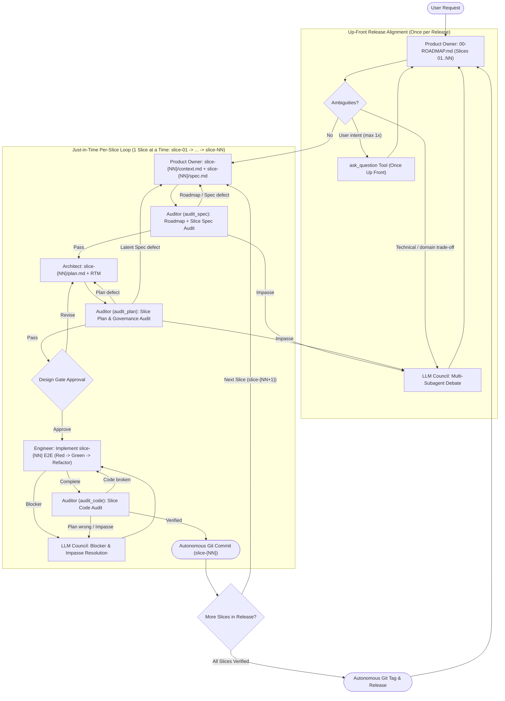
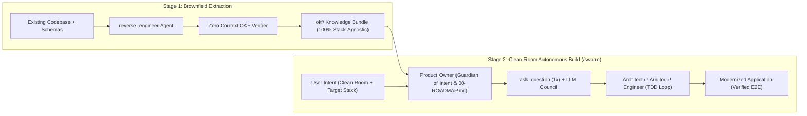

# Swarm & Modernization Toolkit

An [Antigravity Plugin](https://antigravity.google/docs/build-plugins/) that provides a **Multi-Agent Swarm** for autonomous software development, DDD reverse engineering, repository complexity analysis, and agile user story generation.

**Credits**: [@dandobrin](https://github.com/ddobrin), [@jjdelorme](https://github.com/jjdelorme) & [@cedricyao](https://github.com/cedricyao). Parts of this work were adapted from Dan's [production serverless repository](https://github.com/GoogleCloudPlatform/serverless-production-readiness-java-gcp/tree/main/genai/quotes-llm/.gemini/commands).

## Prerequisites
Install the [Google Antigravity CLI (`agy`)](https://antigravity.google/docs/cli/reference) or Antigravity App / IDE.

## Plugin Installation

Install directly from GitHub using the Antigravity CLI:

```bash
agy plugin install https://github.com/jjdelorme/plan-commands
```

Or validate and install from a local clone:

```bash
# Validate plugin.json and all bundled skills/agents
agy plugin validate --strict .

# Install into ~/.gemini/config/plugins/plan-commands
agy plugin install .

# Verify installation
agy plugin list
```

*(Alternatively, run `./deploy.sh` to validate and install locally.)*

That is the whole setup. The plugin bundles **4 skills** (`swarm`, `create-user-stories`, `repo-stats`, `agent-platform-skill-registry`) and **5 custom agents/subagents** (`product_owner`, `architect`, `engineer`, `auditor`, `reverse_engineer`). Antigravity discovers them automatically across your workspace sessions.

### Plugin Directory Structure

```text
plan-commands/
├── plugin.json               # Antigravity plugin manifest
├── README.md                 # Plugin documentation
├── assets/
│   └── logo.svg              # Plugin icon (1:1 SVG)
├── agents/                   # Custom agents & subagents
│   ├── architect/agent.md
│   ├── auditor/agent.md
│   ├── engineer/agent.md
│   ├── product_owner/agent.md
│   └── reverse_engineer/agent.md
└── skills/                   # Bundled skills
    ├── agent-platform-skill-registry/
    ├── create-user-stories/
    ├── repo-stats/
    └── swarm/
```

### Using the Swarm
In any project, invoke `/swarm` or ask Antigravity to use the swarm for a piece of work, for example:

> Use the swarm skill to add OAuth login to this service.

The agent takes on the **Supervisor** role defined by the `swarm` skill and drives the lifecycle below: asking clarifying questions at most **once up front** via `ask_question` (when user intent is ambiguous), debating all technical/domain trade-offs and blockers via a multi-subagent **LLM Council**, pausing once at the **Design Gate** for your approval of `spec.md` and `plan.md`, and then executing construction, verification, commits, and release tagging **100% autonomously**.

---

## 🤖 The Autonomous Swarm

The swarm manages the software development lifecycle with a **Plan -> Audit -> Act -> Verify** state machine. Every hand-off between roles is a file under `plans/`, so the process is inspectable and resumable.

### The Roles
*   **Supervisor (`swarm` skill)**: The Project Manager & Council Chairman. Enforces the state machine, uses `ask_question` at most once up front for user-intent ambiguity, convenes the **LLM Council** (`invoke_subagent`) to debate technical trade-offs and blockers, and autonomously runs `git commit` after each verified slice and `git tag` upon release completion.
*   **Product Owner (`product_owner`)**: The **Guardian of User Intent & the Spec**. Captures your strategic intent and non-negotiable guardrails (e.g., *"clean-room rebuild using only `okf/*`, zero access to legacy code, target architecture and stack constraints"*), decomposes `okf/` capabilities into a sequenced release roadmap of atomic vertical slices (`plans/00-ROADMAP.md`), and writes each vertical slice's dedicated `context.md` and traceable `spec.md` (`INV-`, `AC-`, `EC-`, `C-`) inside `plans/active_releases/{release_version}/slice-{NN}-{slug}/`.
*   **Architect (`architect`)**: The Planner. Discovers repository governance rules, inspects the actual codebase left by prior slices, loads only the 1–2 relevant `okf/` leaf files, and writes a concrete per-slice `plan.md` (`plans/active_releases/{release_version}/slice-{NN}-{slug}/plan.md`) whose Requirements Traceability Matrix maps every spec ID for that single capability to end-to-end TDD tasks and named tests.
*   **Engineer (`engineer`)**: The Builder. Implements **strictly one end-to-end vertical slice at a time** (`slice-{NN}-{slug}`) across DB $\rightarrow$ Service $\rightarrow$ API $\rightarrow$ UI $\rightarrow$ Tests via Red-Green-Refactor TDD and records blockers in `slice-{NN}-{slug}/plan.md` instead of guessing.
*   **Auditor (`auditor`)**: The Gatekeeper, across three adversarial gates per slice. `audit_spec` checks `plans/00-ROADMAP.md` (100% `okf/index.md` coverage and single-capability vertical-slice decomposition) and `slice-{NN}-{slug}/{context.md, spec.md}` against `okf/` before the Architect runs. `audit_plan` checks `slice-{NN}-{slug}/plan.md` against `spec.md` and repository governance before the Engineer runs (rejecting horizontal layer splits or multi-capability batches). `audit_code` walks the slice's traceability matrix, builds, runs the tests, verifies TDD Red-Gate evidence, and hunts for shortcuts before the slice is committed.
*   **Reverse Engineer (`reverse_engineer`)**: The DDD Domain Analyst. Deconstructs legacy applications, data stores, schemas, and screenshots into stack-agnostic Open Knowledge Format (`okf/`) bundles verified by an independent zero-context reviewer.

### 🔄 Protocol Lifecycle



Automated return loops are capped. When an audit cap or engineering blocker is reached, the Supervisor convenes the **LLM Council** (parallel subagents proposing, critiquing, and synthesizing consensus into `answers.md`) rather than looping or halting for manual intervention.

### Workspace Layout
```text
okf/                                       # Optional: Stack-agnostic DDD knowledge bundle (Reverse Engineer)
  index.md                                 # Tier 1 root architectural index & capability catalog
  domain/ | aggregates/ | capabilities/ | reports/ | data-structures/ | tables/
plans/
  00-ROADMAP.md                            # Master roadmap, user intent guardrails & ordered slices (Product Owner)
  research/                                # Pre-flight research reports
  active_releases/{release_version}/       # Release container
    questions.md / answers.md              # Release-level discovery questions and settled decisions (User & LLM Council)
    slice-01-{slug}/                       # Atomic 1-capability E2E vertical slice (Walking Skeleton + 1st capability)
      context.md                           # Slice-scoped research & 1–2 OKF links (<= 150 lines)
      spec.md                              # Slice-scoped contract with INV-/AC-/EC-/C- IDs (<= 250 lines)
      plan.md                              # Slice-scoped E2E TDD tasks, RTM, verification commands, blockers (<= 200 lines)
    slice-02-{slug}/                       # Next atomic 1-capability E2E vertical slice
      context.md
      spec.md
      plan.md
  audit/                                   # Per-slice Auditor reports (git-ignored)
    SPEC_AUDIT_{release_version}_slice-{NN}.md
    PLAN_AUDIT_{release_version}_slice-{NN}.md
    AUDIT_{release_version}_slice-{NN}.md
```

---

## 🏛️ End-to-End Clean-Room Modernization Workflow (`reverse_engineer` → `okf/` → `/swarm`)

For legacy application modernization, the plugin supports a two-stage **Clean-Room Architecture** where the new system is built from scratch using *only* the extracted business specification (`okf/`), preventing legacy framework anti-patterns from leaking into the new stack:



1. **Stage 1 — Extract the Domain into `okf/` (`reverse_engineer`):**
   Run the `reverse_engineer` agent against the existing repository and schemas to produce a verified, stack-agnostic `okf/` bundle:
   > Use the `reverse_engineer` agent to deconstruct this application and its schemas into a complete `okf/` bundle.

2. **Stage 2 — Clean-Room Rebuild Driven by Intent (`/swarm`):**
   Copy `okf/` into a fresh target workspace with **no access to the original source code**, and invoke `/swarm` with your target stack and architectural intent:
   > `/swarm` Build a new application from scratch on [your target stack] using strictly the `@okf/*` specification (clean-room: zero access to legacy code). Iterate through all releases in `00-ROADMAP.md` until 100% of OKF capabilities pass end-to-end.

   * **How `product_owner` enforces your intent:** The `product_owner` reads the Tier 1 `okf/index.md` catalog, maps 100% of capabilities and reports across sequenced releases and vertical slices in `plans/00-ROADMAP.md`, and encodes your clean-room and stack mandates as traceable `C-` constraints in every slice's `spec.md`.
   * **How ambiguities are settled:** If any product/scope intent is ambiguous up front, the Supervisor calls `ask_question` once; all technical and architectural trade-offs across the build are debated and settled autonomously by the **LLM Council** (`[Settled by: LLM Council]` in `answers.md`).

### Extending the Swarm (Optional)
The core swarm is project-agnostic and reads your repository's own governance documents (agent instruction files, contributor guides, architecture indexes) to learn project-specific rules. Put project conventions there rather than editing the agents. You can also route work to specialized agents by adding rules to your project's `GEMINI.md` or `AGENTS.md`:

```markdown
# Swarm Routing & Delegation Rules
- For codebase investigation, delegate to the `reverse_engineer` agent instead of investigating directly.
- The `auditor` agent MUST use the `graphdb` skill when verifying changes.
```

---

## 🛠️ Additional Bundled Skills

Standalone skills for refining requirements, analyzing repositories, and managing the Enterprise Skill Registry.

### User Story Generation (`create-user-stories` skill)
*Generates agile user stories (following INVEST criteria and Gherkin acceptance criteria) from an existing codebase to help understand the current system or prepare for refactoring.*
*   **Skill:** `create-user-stories` (`skills/create-user-stories/SKILL.md`)
*   **Usage:** Invoke `/create-user-stories` or ask the agent to use the `create-user-stories` skill on a target path:
    > Use the `create-user-stories` skill to generate user stories for `src/auth/`.
*   **Output:** `./user-stories.md`

### Repository Scope & Complexity Analyzer (`repo-stats` skill)
*Analyzes any repository's scope, file and line counts, language breakdown, AST and branch complexity hotspots, and 0..5 Complexity Factor, with an optional standalone HTML dashboard.*
*   **Skill:** `repo-stats` (`skills/repo-stats/SKILL.md`)
*   **Usage:** Invoke `/repo-stats` or ask the agent:
    > Analyze this repository's scope and complexity using `repo-stats`.

### Agent Platform Skill Registry (`agent-platform-skill-registry` skill)
*Zero-dependency CLI for creating, updating, installing, and searching skills in the Gemini Enterprise Agent Platform Skill Registry.*
*   **Skill:** `agent-platform-skill-registry` (`skills/agent-platform-skill-registry/SKILL.md`)
