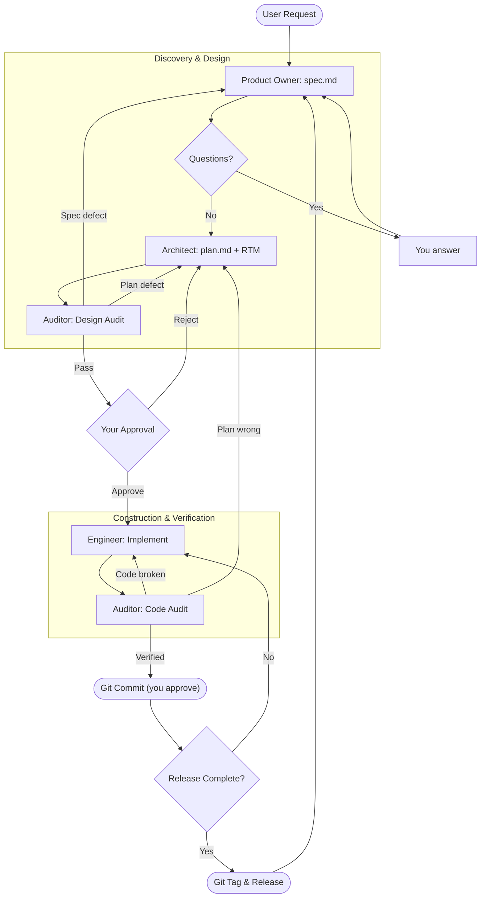

# Swarm & Modernization Toolkit

An [Antigravity Plugin](https://antigravity.google/docs/build-plugins/) that provides a **Multi-Agent Swarm** for autonomous software development, DDD reverse engineering, repository complexity analysis, and agile user story generation.

**Credits**: [@dandobrin](https://github.com/ddobrin), [@jjdelorme](https://github.com/jjdelorme) & [@cedricyao](https://github.com/cedricyao). Parts of this work were adapted from Dan's [production serverless repository](https://github.com/GoogleCloudPlatform/serverless-production-readiness-java-gcp/tree/main/genai/quotes-llm/.gemini/commands).

## Prerequisites
Install the [Google Antigravity CLI (`agy`)](https://antigravity.google/docs/cli/reference) or Antigravity App / IDE.

## Plugin Installation

Install directly from GitHub using the Antigravity CLI:

```bash
agy plugin install https://github.com/jjdelorme/plan-commands
```

Or validate and install from a local clone:

```bash
# Validate plugin.json and all bundled skills/agents
agy plugin validate --strict .

# Install into ~/.gemini/config/plugins/plan-commands
agy plugin install .

# Verify installation
agy plugin list
```

*(Alternatively, run `./deploy.sh` to validate and install locally.)*

That is the whole setup. The plugin bundles **4 skills** (`swarm`, `create-user-stories`, `repo-stats`, `agent-platform-skill-registry`) and **5 custom agents/subagents** (`product_owner`, `architect`, `engineer`, `auditor`, `reverse_engineer`). Antigravity discovers them automatically across your workspace sessions.

### Plugin Directory Structure

```text
plan-commands/
├── plugin.json               # Antigravity plugin manifest
├── README.md                 # Plugin documentation
├── assets/
│   └── logo.svg              # Plugin icon (1:1 SVG)
├── agents/                   # Custom agents & subagents
│   ├── architect/agent.md
│   ├── auditor/agent.md
│   ├── engineer/agent.md
│   ├── product_owner/agent.md
│   └── reverse_engineer/agent.md
└── skills/                   # Bundled skills
    ├── agent-platform-skill-registry/
    ├── create-user-stories/
    ├── repo-stats/
    └── swarm/
```

### Using the Swarm
In any project, invoke `/swarm` or ask Antigravity to use the swarm for a piece of work, for example:

> Use the swarm skill to add OAuth login to this service.

The agent takes on the **Supervisor** role defined by the `swarm` skill and drives the lifecycle below, stopping for your input only at the discovery questions, the plan approval gate, each commit, and each release tag.

---

## 🤖 The Autonomous Swarm

The swarm manages the software development lifecycle with a **Plan -> Audit -> Act -> Verify** state machine. Every hand-off between roles is a file under `plans/`, so the process is inspectable and resumable.

### The Roles
*   **Supervisor (`swarm` skill)**: The Project Manager. Enforces the state machine, relays questions and blockers to you, and is the only participant that runs `git commit`.
*   **Product Owner (`product_owner`)**: The Visionary. Turns your request and the research context into a traceable `spec.md` with stable requirement IDs, preserving domain rules verbatim, and maintains the Master Roadmap (`plans/00-ROADMAP.md`).
*   **Architect (`architect`)**: The Planner. Discovers repository governance rules, then writes a concrete `plan.md` whose Requirements Traceability Matrix maps every spec ID to a task and a named test.
*   **Engineer (`engineer`)**: The Builder. Implements one task at a time via Red-Green-Refactor and records blockers in the plan instead of guessing.
*   **Auditor (`auditor`)**: The Gatekeeper, in two modes. `audit_design` checks the spec against the research and the plan against the spec and governance before you are asked to approve anything. `audit_code` walks the traceability matrix, builds, runs the tests, and hunts for shortcuts before anything is committed.
*   **Reverse Engineer (`reverse_engineer`)**: The DDD Domain Analyst. Deconstructs legacy applications, data stores, and brownfield codebases into stack-agnostic Open Knowledge Format (`okf/`) bundles or Phase 0 Research Context Reports (`plans/research/<topic>.md`).

### 🔄 Protocol Lifecycle



Automated return loops are capped. If the design audit rejects twice, the Supervisor stops and shows you the impasse rather than looping.

### Workspace Layout
```text
plans/
  00-ROADMAP.md                      # Master roadmap & project versioning scheme (Product Owner)
  research/                          # Context reports before a release is formed
  active_releases/{release_version}/ # Sole organizing unit for delivery & verification
    context.md                       # Research the spec must stay faithful to
    questions.md / answers.md        # Discovery questions and your decisions
    spec.md                          # Contract with INV-/AC-/EC-/C- IDs
    plan.md                          # Tasks, RTM, governance mandates, blockers
  audit/                             # Auditor reports (git-ignored)
```

### Extending the Swarm (Optional)
The core swarm is project-agnostic and reads your repository's own governance documents (agent instruction files, contributor guides, architecture indexes) to learn project-specific rules. Put project conventions there rather than editing the agents. You can also route work to specialized agents by adding rules to your project's `GEMINI.md` or `AGENTS.md`:

```markdown
# Swarm Routing & Delegation Rules
- For codebase investigation, delegate to the `reverse_engineer` agent instead of investigating directly.
- The `auditor` agent MUST use the `graphdb` skill when verifying changes.
```

---

## 🛠️ Additional Bundled Skills

Standalone skills for refining requirements, analyzing repositories, and managing the Enterprise Skill Registry.

### User Story Generation (`create-user-stories` skill)
*Generates agile user stories (following INVEST criteria and Gherkin acceptance criteria) from an existing codebase to help understand the current system or prepare for refactoring.*
*   **Skill:** `create-user-stories` (`skills/create-user-stories/SKILL.md`)
*   **Usage:** Invoke `/create-user-stories` or ask the agent to use the `create-user-stories` skill on a target path:
    > Use the `create-user-stories` skill to generate user stories for `src/auth/`.
*   **Output:** `./user-stories.md`

### Repository Scope & Complexity Analyzer (`repo-stats` skill)
*Analyzes any repository's scope, file and line counts, language breakdown, AST and branch complexity hotspots, and 0..5 Complexity Factor, with an optional standalone HTML dashboard.*
*   **Skill:** `repo-stats` (`skills/repo-stats/SKILL.md`)
*   **Usage:** Invoke `/repo-stats` or ask the agent:
    > Analyze this repository's scope and complexity using `repo-stats`.

### Agent Platform Skill Registry (`agent-platform-skill-registry` skill)
*Zero-dependency CLI for creating, updating, installing, and searching skills in the Gemini Enterprise Agent Platform Skill Registry.*
*   **Skill:** `agent-platform-skill-registry` (`skills/agent-platform-skill-registry/SKILL.md`)
